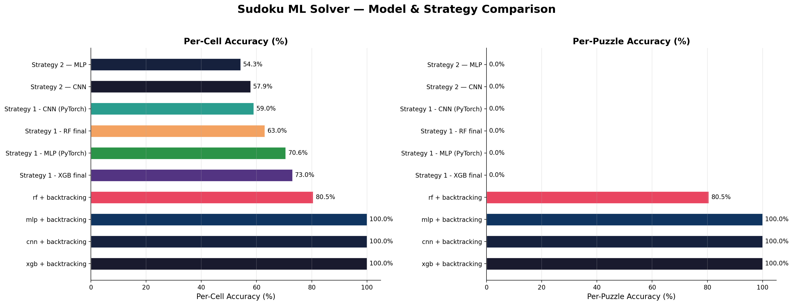

# Solving Sudoku with Machine Learning

Machine Learning course project, Free University of Bozen-Bolzano, June 2026 · Full report: [`ML_project_report_Eskicioglu_Macek.pdf`](ML_project_report_Eskicioglu_Macek.pdf)

Classical approaches such as backtracking, constraint propagation and evolutionary algorithms are well established and highly effective for solving Sudoku puzzles. In this project, however, we investigate how well machine learning models can perform on this task, both on their own and as helpers for a classical solver.

## Data and Methodology

- **Dataset:** we use 50,000 puzzles randomly sampled from the 9 Million Sudoku Puzzles and Solutions dataset ([Kaggle]([https://www.kaggle.com/datasets/rohanrao/sudoku])), where each puzzle is represented as 81-character string and has about 45 empty cells on average. They are split into 40,000 puzzles for training, 5,000 for validation and 5,000 for testing.
- **Encoding:** each puzzle is converted into a 9×9×9 one-hot tensor, which is flattened to 729 features for all models except the CNN, which keeps the 3D structure.
- **Metrics:** we report per-cell accuracy and per-puzzle accuracy (a puzzle counts as correct only if all 81 cells match the solution).

## Strategies

1. **Full-grid prediction:** the model predicts all 81 cells at once. Random Forest and XGBoost use 81 classifiers (one per cell), the MLP and CNN predict all cells jointly.
2. **Step-by-step prediction:** the model fills the cell it is most confident about, re-encodes the grid and repeats (MLP and CNN).
3. **ML-guided backtracking:** the model ranks the digits 1–9 for each empty cell, and backtracking tries them in that order instead of starting from 1 (RF, XGBoost, MLP, CNN).

## Results

- **ML alone does not solve Sudoku.** Strategies 1 and 2 reach 54–73% per-cell accuracy (XGBoost is the best, at 73%), but 0% per-puzzle accuracy: small local errors add up, so no complete valid grid is produced.
- **Choosing the most confident cell (Strategy 2) does not improve per-cell accuracy** over predicting everything at once.
- **With backtracking, the MLP, CNN and XGBoost solve 100% of the test puzzles.** Random Forest solves 80.5%.
- **Pure backtracking is faster.** Running the ML model at every step outweighs the smaller search:

| Puzzle set | Method | Solved | Avg time (s) |
|---|---|---|---|
| 50 random test puzzles | Pure backtracking | 50/50 | 0.0190 |
| 50 random test puzzles | ML-guided backtracking | 50/50 | 0.1340 |
| 30 harder test puzzles | Pure backtracking | 30/30 | 0.0129 |
| 30 harder test puzzles | ML-guided backtracking | 30/30 | 0.1154 |

The puzzles in our dataset are not hard enough for plain backtracking, so we cannot tell whether ML guidance helps on genuinely difficult instances. This is the natural next step.

## Run it

1. Install any packages imported at the top of the notebook that you don't have yet (`pip install <package>`).
2. The 50,000-puzzle sample is included in `data/` ([file name]), so no download is needed. It is drawn from the full 9-million-puzzle dataset on [Kaggle]([https://www.kaggle.com/datasets/rohanrao/sudoku]).
3. Run `sudoku_solver.ipynb` from top to bottom.

## Team

Project by **Valentina Macek** and **Zeynep Eskicioğlu**. Together we design the strategies; Zeynep implements Strategies 1 and 3, and Valentina implements Strategy 2 and the comparison with pure backtracking. Together we interpret the results and write the report.

## Reference

S. Jana, M. Sen, A. Khan, A. K. Maji and R. K. Pal. *Analysing the effectiveness of different machine learning approaches towards solving Sudoku puzzle.* International Conference on Data, Electronics and Computing, Springer, 2025.
